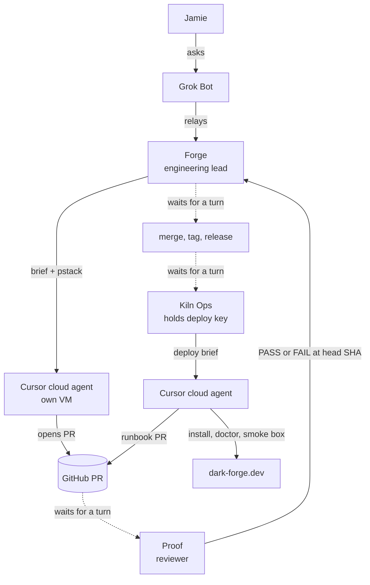
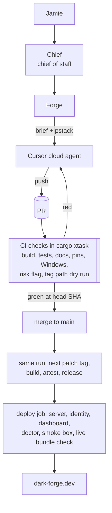
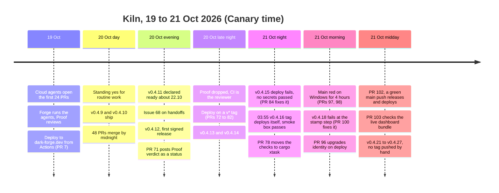

+++
title = "100 merged PRs in two days, and why none of that was the slow part"
date = 2026-10-21
draft = false
description = "How I used Grok Bot and Cursor cloud agents to ship kiln, why getting changes to production still took all day, and what I changed so CI does the reviewing and the deploying."
tags = ["ai", "engineering", "developer-tools", "kiln"]
+++

Between lunchtime on 19 October and 14:45 on 21 October, cloud agents opened 108 pull requests on [kiln](https://github.com/Jabbslad/kiln). 100 of them merged. I didn't write a line of that code, and I didn't review most of it either.

*Updated 21 October, 15:00 Canary time. I first wrote this with data up to 01:43 that morning. The numbers, charts and timeline now run to 14:45, and the section [What happened next](#what-happened-next) covers the 13 hours in between.*

That sounds like the good news. The catch is that it still took me most of 20 October to get one release onto my server, and the reason wasn't the code. This post is about what was slow and what I changed. By the afternoon of 21 October, a merged PR was live on the server about 10 minutes later, and nobody pushed a tag.

Much of this setup follows how [poteto](https://x.com/poteto) (Lauren Tan) works with agents. Most of the good ideas below started as one of her posts, and I've embedded the ones that changed my setup the most.

## The setup

Kiln is a small runtime for Firecracker microVMs. You ask it for a "box", it boots one, and you get SSH, a dashboard, and a sign-in that goes through dark-forge.dev. It runs on a single bare-metal host.

I drive it from Grok Bot, a desktop assistant app where I can run several bots side by side. At first I just asked Grok Bot to kick off coding jobs directly. That worked, but my main chat filled up with build logs and PR links.

So I made Forge. Forge is an engineering lead that never writes code. It turns my asks into Cursor cloud agent jobs. Each agent runs in its own VM, does the work, and opens a PR. Forge then follows the PR through to merge and release.

Every brief Forge writes tells the agent to use [pstack](https://github.com/cursor/plugins/tree/main/pstack), poteto's skill pack. Its rules are short: make the smallest diff, fix the root cause, and prove it works.

The PR titles from 19 October show what that bought me. The agents moved the installer from Python to bash (#14), added a deploy to dark-forge.dev from GitHub Actions (#7), put the CLI behind identity sign-in (#19), and started serving the dashboard API (#25). The first PR opened at 12:58. By 02:23 the next morning, 27 had merged.

## The bot team

One bot opening PRs is easy. The harder question was who checks them.

Around 19 October I added Proof, an independent reviewer. Proof read the diff, then drove each change like a user would, posted the evidence, and gave a PASS or FAIL verdict naming the exact commit SHA it tested. The group chat I'd called "Forge review" turned into the "Kiln" chat, where the bots talked to each other.

Then I added Kiln Ops, the deploy bot. It is the only bot that holds the deploy key for the dark-forge.dev host. Kiln Ops can only make outbound HTTPS calls, so it deploys through cloud agents as well. Every deploy pins Firecracker 1.17.0, runs `kiln-runtime doctor` (which has to report `development_ready: true`), boots a real box as a smoke test, and records a runbook PR.

I also adopted poteto's shipping rules:

- Merge only with a verdict at the PR's current head SHA.
- One PR at a time, bottom of a stack first.
- Read each PR back after it merges, to confirm it landed.

On 20 October I gave the bots a standing yes. Routine PRs, merges, releases and deploys no longer needed me. A short list still does: force-pushes, tags and branches, repo settings, secrets and keys, `authorized_keys`, and anything touching identity or login.

This is what the flow looked like that day:

Diagram source

## The bottleneck

On paper, 20 October was a huge day. 48 PRs merged between midnight and midnight. Most of it happened between 09:00 and midnight, and the busiest stretch ran from 15:00 to 18:00. Eight PRs opened in the 15:00 hour alone.

From inside it felt slow. In the afternoon I asked Grok Bot:

> Why so few? Stuff has been happening all day but I'm struggling to understand why it's taken so long for anything to get deployed.

Grok Bot's answer was that each handoff was a bot waiting for another bot's turn. A review was requested, then a verdict came back, then someone merged, tagged, released, and deployed. None of those steps ran on their own. Each one waited for some bot to notice it was up. A review took about 15 minutes, and every FAIL meant another round trip.

My reply was "Even 15 mins isn't quick."

The numbers back that up. v0.4.11 was published at 19:43. It wasn't deployed and declared ready until about 22:10, after I tested `kiln login` from a machine that wasn't the host. That's close to two and a half hours from release to "it works", for a release that was already built and packaged.

The issue Grok Bot wrote that night says it plainly. On 20 October "six PRs merged ... and v0.4.11 shipped, but it took all day. Most of the delay wasn't review or CI." One PR, #66, "sat idle after rework because nobody re-requested review from Proof."

## The fixes

I made the changes one at a time, in this order.

**Faster reviews.** Reviews had to be quick. Notes that didn't block a merge went into one cleanup PR at the end of the day, and FAIL was kept for real blockers.

**Issue #68.** Grok Bot opened ["Make the PR-to-deploy handoffs deterministic"](https://github.com/Jabbslad/kiln/issues/68). It proposed three things: re-request review on every push, auto-merge when the checks are green, and deploy when a `v*` tag is pushed.

**Verdicts as a status.** PR #71 posted Proof's verdict as a `proof` commit status. That gave the merge a machine-readable gate instead of a chat message.

**A new rule.** Any test or check step becomes code, either a script or a CI job, instead of something an agent runs by hand.

That last rule is where things really changed, and poteto had already written about it. Her team runs an agentic code review that rates every PR for risk, and the low and medium risk ones merge without a human review:


we have agentic code review, so every PR gets assessed for risk. low-medium risk ones don't require a review so you just merge it. also bugbot of course

there's many more interesting ideas we have for the agentic forge that we've been discussing cc @jacobgold


The next day she put it more bluntly:


anything requiring a human review step is ngmi


A week later she posted what she calls an inverse pyramid of trust. Most of the effort goes into the codebase itself (types, invariants, clear boundaries), then static analysis and tests, then prose like rules and skills, and the least into human review:


how do you trust your agents' work more? copy this post/link and give it to your @bot or agent!

1. codebase improvements: this is just good software engineering - better architecture, stronger types and invariants, clear boundaries. agents love to copy what exists and take the shortest path, so make the easy thing the right thing. categorically eliminate problems through code and you won't need to think about it again.
2. static analysis: lint rules, tests, CI, verification (eg TLA+). very token efficient ways to catch issues ahead of time.
3. prose: comments, rules, AGENTS.md, skills - anything that can't be enforced and requires agent judgment. use it minimally, but do use /create-verification-skill.
4. human review: the hardest to scale. at the rate agents land code, it's pretty much impossible to thoroughly review every PR, so spend that effort on the highest leverage point, designing an environment where agents do the right thing by default.

this forms an inverse pyramid: you want most of your effort at the top, least at the bottom.


She also [reviews the videos and screenshots her agents record](https://x.com/poteto/status/2107529532144234937) rather than reading every diff.

Proof was a review step on every single PR, which is the part of that pyramid she spends the least on. So later that night I dropped Proof completely.

**CI is the reviewer.** A PR now merges when every CI check is green at its current head. The things Proof used to check by hand became coded checks. PR #74 added guards for attestation, secrets and tool downloads. PR #80 refuses a release tag that doesn't match the Cargo version. PRs that touch workflows, deploy, login or secrets get a risk flag from CI.

**Deploy from a tag.** PRs #72, #75, #76, #77 and #80 to #82 moved the deploy into the release build. Push a `v*` tag, and the build that publishes the release goes on to deploy it, then opens the installer re-pin PR.

**Signed releases.** v0.4.12, published at 22:25, was the first signed release. It carries GitHub build attestations that I can check with `gh attestation verify`. Kiln Ops deployed it with every signature verified and the smoke box passing.

**Chief.** I also set up Chief, a chief-of-staff bot. poteto talks mostly to her chief of staff, who talks to her engineering lead, and I copied that. I talk to Chief, Chief relays to Forge, and the engineering chatter stays out of my main chat.

Here's the pipeline now, including the changes from 21 October that I cover further down:

Diagram source

## The result

I split the merged PRs into three phases by when they were opened, and measured the time from open to merge.

| Phase | Merged PRs | Median | P90 |
|---|---|---|---|
| 19 Oct 12:58 to 20 Oct 02:23 (setup) | 27 | 23 min | 86 min |
| 20 Oct 09:00 to 22:57 (bot handoffs) | 38 | 20 min | 91 min |
| 20 Oct 23:00 to 21 Oct 14:45 (CI is the reviewer) | 35 | 12 min | 46 min |

When I first wrote this, the last phase had 10 PRs, with a median of 10 minutes and a P90 of 35. It now has 35 PRs. The median is 12 minutes, still about half of the earlier phases. The P90 grew to 46 minutes, which is still half of the bot-handoff phase. The two slowest were [#96](https://github.com/Jabbslad/kiln/pull/96) at about four and a half hours, an identity change that needed my yes, and [#78](https://github.com/Jabbslad/kiln/pull/78) at just over four hours, the `cargo xtask` port, which had to take in everything that merged to main while it was open.

Releases sped up too. v0.4.12, v0.4.13 and v0.4.14 were published at 22:25, 23:58 and 00:42. Each tag build took between 5 and 7 minutes.

Across the whole run, from v0.4.1 on the morning of 19 October to v0.4.27 at 14:44 on 21 October, kiln shipped 25 releases. 11 of them came on 21 October.

Diagram source

## What happened next

When I first published this, the deploy half wasn't finished. The v0.4.14 tag build had skipped its deploy job, and #81 fixed that path. The v0.4.15 build then got all the way to the deploy job and failed at "Install the release".

**The empty key.** The log said the SSH key was empty. The deploy job reads two secrets from the `dark-forge` environment, and it runs as a reusable workflow. GitHub only passes secrets into a reusable workflow when the caller asks it to. The build called the deploy with no `secrets:` key, so the job got empty strings and ran anyway. [#84](https://github.com/Jabbslad/kiln/pull/84) added `secrets: inherit`, plus a CI guard that fails any caller that leaves it out. A manual run of the Deploy workflow at 02:17 put v0.4.15 on the server.

**The first hands-off deploy.** At 03:52 a cloud agent pushed the v0.4.16 tag. The build deployed it, `kiln-runtime doctor` reported `development_ready: true`, and the smoke box booted. The deploy went green at 03:55. That's the run I said I'd write a follow-up about: a tag push to a passing smoke box with nobody touching it. v0.4.17 did the same at 04:44.

**Main went red for four hours.** [#78](https://github.com/Jabbslad/kiln/pull/78) merged at 05:04 and moved the CI checks from Python to `cargo xtask`. The Windows client job on main failed straight away. A release test read a bash script, and on Windows Git checks that script out with CRLF line endings. The parser looked for LF markers, found none, and panicked. The PR had been green because that test only ran on a push to main, never on a pull request. Nothing merged to fix it until the morning. [#97](https://github.com/Jabbslad/kiln/pull/97) fixed the parser at 08:47, and [#98](https://github.com/Jabbslad/kiln/pull/98) fixed the test and made the Windows release tests run on pull requests. Main went green again at 09:05.

**A tag that never shipped.** At 09:24 the v0.4.18 tag build failed while stamping the version onto the binaries it reused from main. There is no v0.4.18 release. [#100](https://github.com/Jabbslad/kiln/pull/100) fixed the stamp and added a dry run of the whole tag path. Pull requests now run that dry run.

**Identity.** [#96](https://github.com/Jabbslad/kiln/pull/96) made the deploy upgrade `kiln-identity`, the sign-in service, alongside the server. It checks the login pages after the install. It touches login, so it was on my list of things that need my yes. The PR records that it got one.

**No more tags.** [#102](https://github.com/Jabbslad/kiln/pull/102) merged at 11:29. A green push to main now creates the next patch tag in the same run, then builds, attests, publishes the release and deploys it. Docs-only pushes don't release. Since then kiln has shipped seven releases, v0.4.21 to v0.4.27. Each one went from merge to a green deploy in about 9 to 10 minutes. #102 set a budget of five minutes from CI going green to the deploy finishing, and all seven came in under it. On 20 October, v0.4.11 took about two and a half hours from published to working.

**Green didn't mean live.** v0.4.20 shipped a new dashboard, but the deploy never installed it. The server kept serving the old bundle and the job still went green. [#103](https://github.com/Jabbslad/kiln/pull/103) installs the dashboard on every deploy. It then fails the job if the live site serves a different bundle from the one in the release.

**Green didn't mean it worked.** [#107](https://github.com/Jabbslad/kiln/pull/107) put copyable `kiln ssh` commands in the dashboard's Access panel. It passed every check, merged at 13:57 and was live in v0.4.25 at 14:07. But from a laptop, `kiln ssh` goes through the public door, and the public door doesn't serve SSH. [#109](https://github.com/Jabbslad/kiln/pull/109) reverted it at 14:18, and v0.4.26 was live at 14:28. Shipping the fix took the same 10 minutes as shipping the mistake. No check caught it, because no check runs `kiln ssh` from outside the host.

On 21 October, up to 14:45, 32 PRs merged and 11 releases shipped. Every one of those releases deployed from CI and passed its smoke box.

## What I learned

Agents writing code was never the slow part. On my busiest day the agents opened 47 PRs, and the median one merged 18 minutes after it opened. The slow part was everything between "merged" and "running on the server": a bot waiting for another bot, a review that had to be asked for again, a deploy that started when someone noticed it was time.

Every one of those waits was a check that lived in a bot's head. Proof knew how to drive a change like a user. Kiln Ops knew to run `doctor` and boot a smoke box. Forge knew to re-request review after a push. When that knowledge sits in a bot, it runs whenever the bot gets around to it. In CI it runs on every push.

So my rule now is simple. If a bot checks something by hand, that check should be a CI job.

21 October added three things to that rule. A check that only runs after merge doesn't protect main, so the Windows tests now run on pull requests too. A deploy has to check what's actually live, not just that its own steps finished. And CI only checks what it can reach. Everything in kiln's CI runs on GitHub's runners or on the host. The SSH mistake only shows up from a laptop on the outside.

## What's next

When I first wrote this, the list here had two items. Both are done. The deploy went green on its own at 03:55 on 21 October, and #78 merged at 05:04. What's left:

- SSH from a laptop. The Access panel says "Not available yet" until the public door serves SSH. When it does, the smoke test should run `kiln ssh` from outside the host.
- Five PRs are still open. [#89](https://github.com/Jabbslad/kiln/pull/89) touches login, so it waits for my yes. [#110](https://github.com/Jabbslad/kiln/pull/110) proposes dropping Windows from the shipped clients.
- Keep moving checks down the pyramid. Every time I catch myself asking a bot "did you test X?", that's a missing CI job.

Thanks to poteto for writing so openly about how she works with agents. This setup would look very different without her posts.
